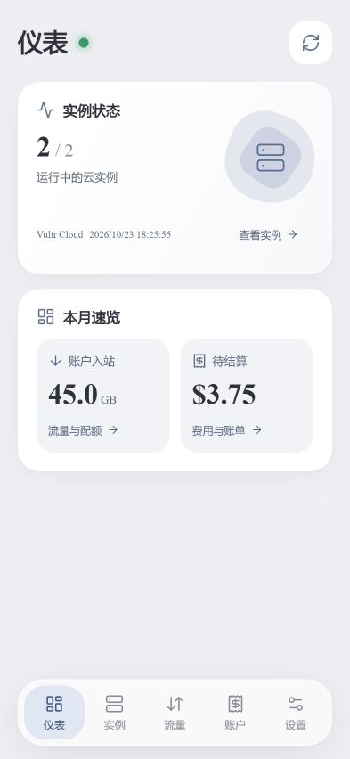
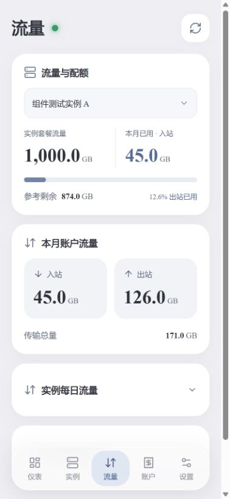
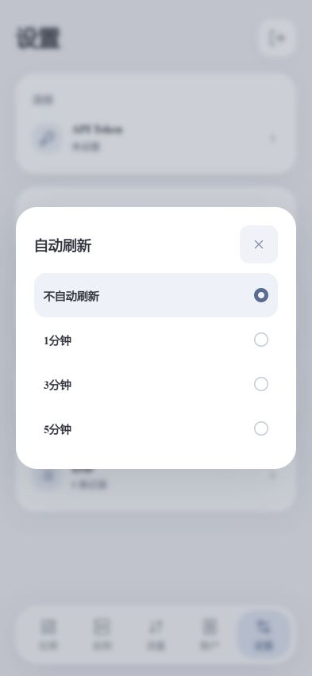

# Vultr Pocket · Vultr 掌上云管

**Your Vultr instances, bandwidth and bills — in one lightweight Android dashboard.**

[简体中文](README.zh-CN.md) · [Build from source](docs/BUILDING.md) · [Data semantics](docs/DATA.md) · [Security](SECURITY.md)


Vultr Pocket is an unofficial, self-contained Android VPS monitor. It connects directly to the Vultr v2 REST API from native Android code, with a bundled HTML/CSS/JavaScript interface. No server to deploy, no monitoring agent to install, no analytics service.

The current app interface is in Simplified Chinese. This repository contains the source and build instructions; a prebuilt public release is not included.

<p align="center">
  
  
  
</p>

Screenshots are browser previews with **synthetic component-test data**, not a real account or Android device capture. Documentation IP addresses are used. The preview adapter is not bundled in the APK.

## What it does

| Tab | Features |
| --- | --- |
| Overview | Instance status, account inbound traffic, pending charges and last data acquisition time |
| Instances | Region, plan, IPv4/IPv6, assigned vCPU/RAM/disk; tap an IP to copy |
| Traffic | Monthly inbound/outbound totals, estimated plan quota remaining, account bandwidth credits and scrollable daily curves |
| Account | Pending charges, available-balance presentation, recent invoices and last payment |
| Settings | Native token entry, password change, local error logs, foreground auto-refresh and optional instance reboot |

- **Local credentials.** Set your own app password on first launch. The API token is entered through a native dialog and encrypted with Android Keystore; JavaScript never receives it.
- **Convenient return visits.** Remember-login uses an encrypted, fixed 30-day ticket. System verification uses the Android authentication prompt, with supported biometrics or device credentials as available on the device.
- **Designed for weak networks.** Show an eligible cached snapshot first, then refresh. Failed requests keep older data without advancing the last-success timestamp. Details stay in local logs.
- **Foreground refresh only.** Choose off, 1, 3 or 5 minutes. Startup/automatic requests respect a persisted 60-second success guard; explicit manual refresh bypasses that guard. No background refresh worker.
- **Monitoring by default.** Reboot is disabled until enabled in settings. Each reboot requires native confirmation and sends one fixed v2 reboot request; it is never automatically retried.
- **Small dependency surface.** Java + the Android platform, local SVG icons and fonts, plain web assets. No Gradle, Node packages or third-party Java runtime dependencies.

## Start using it

1. [Build and sign the APK](docs/BUILDING.md), then install it on Android 8.0 or later. Java DEX supports arm64-v8a without native ABI libraries.
2. Create an app access password on first launch. There is **no shared default password**.
3. In **设置 → API Token**, enter a token created in your own [Vultr API settings](https://my.vultr.com/settings/#settingsapi). This token belongs to your Vultr account; it is not a project-provided credential.
4. Configure Vultr's API access controls for the network from which the phone connects. A valid token can still be denied by the source-IP ACL. Do not post the token or an unredacted error dump in an issue.
5. Refresh the dashboard. Review **设置 → 日志 → 视图** if a connection indicator is red.

Your token can carry permissions beyond monitoring. The app's endpoint restrictions do not reduce the token's privileges at Vultr. Treat the phone and token accordingly; see [Security](SECURITY.md).

## Try the interface without a token

With Node.js 22+ installed:

```sh
node tools/preview.cjs
```

Open `http://127.0.0.1:8088`, create a temporary preview password and explore the sample dashboard. This developer-only loopback preview uses synthetic data, never calls Vultr, and keeps its state in memory. Restarting it resets the preview password. Native token entry and system verification require the Android app.

## Understand the numbers

- Daily instance bandwidth is a UTC series returned by Vultr, requested over up to 60 days. It is **not live network speed**; missing dates remain blank.
- Instance bandwidth bytes are displayed as decimal GB. Plan remaining is an **estimate based on instance outbound traffic**, not an assertion about a pooled account allowance.
- Account totals come from `/account/bandwidth`; they need not equal the sum of the visible compute instances. Inbound totals are not outbound billing usage.
- Account amounts are USD, displayed with `$`. There is no exchange-rate conversion. The balance card reverses the API balance sign to present available credit; pending charges are shown separately.
- Configured vCPU, RAM and disk are capacities, not usage measurements. There is no CPU-utilization agent or real-time host telemetry.
- “运行中” reflects control-plane status, not application or SSH health. An accepted reboot request does not prove the guest has finished restarting.

See [API fields, limitations and official references](docs/DATA.md) for the complete definitions.

## Development

```powershell
pwsh -File tests/run.ps1
```

The suite runs pure-JVM policy tests and Node-based UI/bridge tests without a token or Android device. [Build instructions](docs/BUILDING.md) describe the SDK and signing steps.

```text
src/app/vultrpocket/mobile/   Native API, vault, authentication, lifecycle and dialogs
assets/web/                  Bundled interface; no API credentials
tests/                       JVM and JavaScript regression checks
tools/                       Synthetic browser preview; excluded from APK
docs/                        Build guide, data definitions and sample screenshots
licenses/                    Font and icon licenses
```

**Validation limits:** local tests and APK compilation do not establish real-device Keystore, biometric, cold-start, background/network or reboot behavior. No live reboot acceptance test is included. Test on a disposable instance before relying on optional reboot controls.

## Contribute

Bug reports, small fixes and documentation improvements are welcome. Read [CONTRIBUTING.md](CONTRIBUTING.md); include reproduction steps and redacted logs, never live credentials or account details. Report security issues privately as described in [SECURITY.md](SECURITY.md).

## License and attribution

Project code is [MIT licensed](LICENSE). Bundled Tinos fonts use SIL OFL 1.1 and Lucide-derived SVG icons use ISC; their notices remain in [licenses/](licenses/) and [THIRD_PARTY_NOTICES.md](THIRD_PARTY_NOTICES.md). Times New Roman is not redistributed.

Vultr Pocket is independent and is not affiliated with, endorsed by, or an official product of Vultr. Vultr names identify the service with which this application interoperates.
