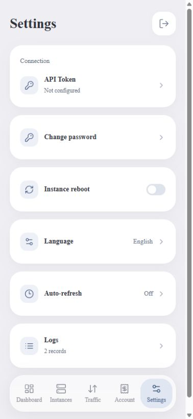
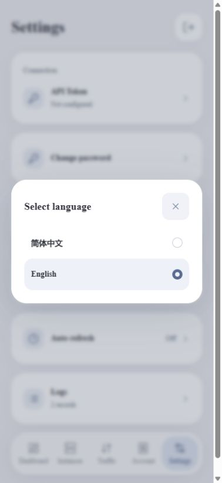

# Languages / 中英文切换

The app defaults to **Simplified Chinese**, independent of the device's language. Open **设置 → 语言 → English** to use English. To switch back, use **Settings → Language → 简体中文**. The selection is saved on the device and returned with the local session, including before login.

应用默认简体中文，在设置里的“语言”选择中切换。选择器复用实例/自动刷新的圆角弹窗、单选标记和键盘操作，关闭按钮为 48 CSS 像素，选项触摸高度至少 56 CSS 像素。保存失败保留原语言，不清除登录凭据、Token 或缓存，不触发 Vultr API 刷新。

<p align="center">
  
  
</p>

These are browser previews using synthetic data, not Android device captures.

## Translation source

- `assets/web/locales/en.json` is the single English message catalog. Chinese source messages are the keys and fallback text.
- `tools/sync-locales.cjs` creates ignored `assets/web/i18n-data.js` for the bundled page. Both the build and preview run it automatically. It needs Node.js 22+, without npm packages.
- `assets/web/i18n.js` handles language validation, fallback and named placeholders. The page sets its HTML `lang` attribute and number/date locale.
- Native `I18n.java` reads the same JSON directly from APK assets. Token/password dialogs, confirmation buttons, reboot notices and app-owned authentication errors use it.
- `LanguagePolicy.java` accepts only `zh-CN` and `en`. `Vault` saves the preference; the authenticated local settings operation does not use a network request or change credential state.

No online translation service, remote locale download, added Java runtime library or backend is used. Never translate data supplied by the account: instance names, IPs, OS/plan names and original invoice descriptions remain intact. Existing local error messages are translated for display without rewriting the stored message.

Android's own biometric/passcode interface follows the **device OS language and capabilities**. The app does not replace or translate system-owned controls; the app-supplied authentication title remains visually blank.

## Validate changes

```powershell
node tools/sync-locales.cjs
pwsh -File tests/run.ps1
```

Regression checks cover both languages, every main view, placeholders, native message coverage, default/fallback behavior, unsupported preference rejection, failure rollback, session language restoration and preservation of user-provided instance names. Browser reload verifies preview persistence; real Android relaunch/Keystore/system-authentication validation still requires a test device.
